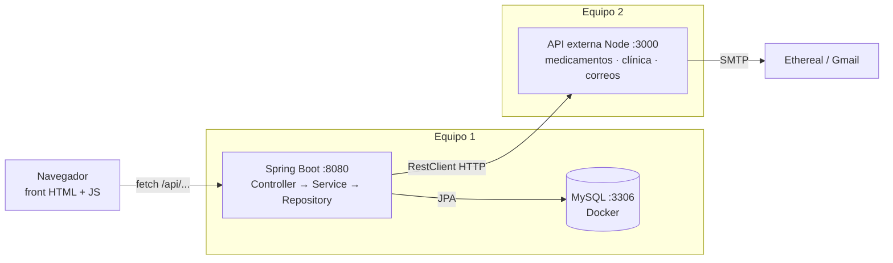
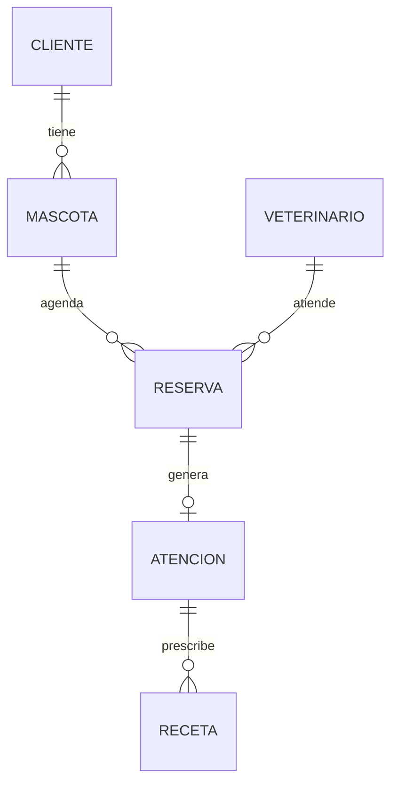
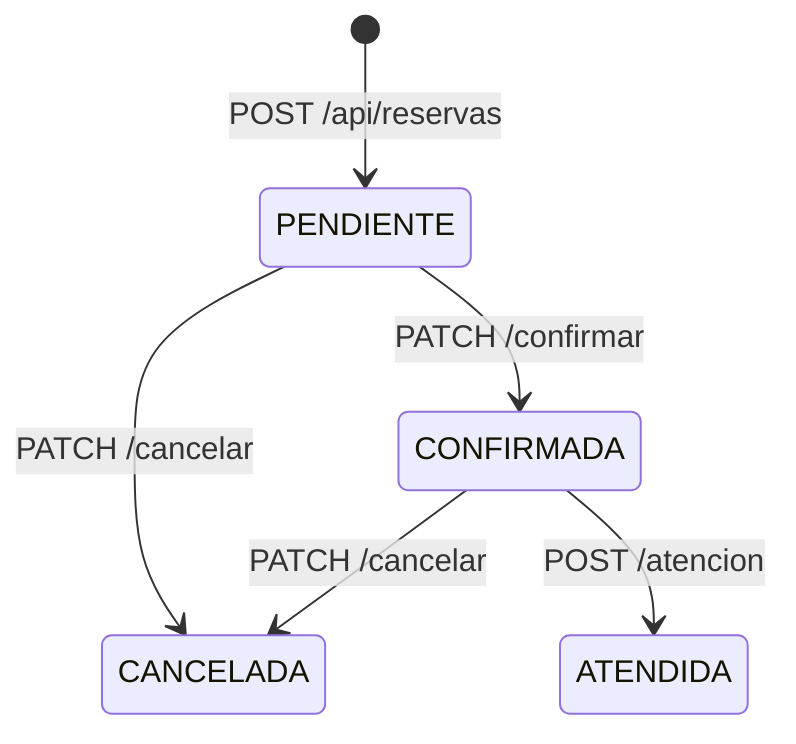

# PetCare – Sistema de Gestión de Atención Veterinaria

Estudio de Caso 2 · Desarrollo Web Orientado a Objeto

**Integrantes:** Gonzalo · María Zapata Fica

Sistema web para la clínica veterinaria PetCare (Chillán) que centraliza clientes, mascotas, veterinarios, horas médicas e historial clínico. Está construido con **Spring Boot 3 + MySQL** y consume una **API externa en Node.js** que corre en un segundo equipo de la red y entrega medicamentos, geolocalización y envío de correos.

---

## 1. Arquitectura



- El **navegador solo habla con Spring**. Spring hace de puente hacia la API Node (clase `ApiExternaClient`).
- Si la API Node se cae, las reservas igual se confirman o cancelan; la respuesta indica que el correo no se pudo enviar.

### Capas del backend

| Capa | Paquete | Responsabilidad |
|---|---|---|
| Controller | `controller` | Recibe HTTP, valida con `@Valid`, devuelve DTOs |
| Service | `service` | Reglas de negocio (duplicados, estados, horarios) |
| Repository | `repository` | Acceso a datos con Spring Data JPA |
| Model | `model` | Entidades JPA mapeadas a las tablas |
| DTO | `dto`, `dto/externo` | Objetos de entrada/salida (records) |
| Client | `client` | Consumo de la API externa Node |
| Exception | `exception` | Errores propios + `GlobalExceptionHandler` |
| Validation | `validation` | Anotación `@RutValido` (dígito verificador) |

### Modelo de datos



### Estados de una reserva



✉️ = envía correo al cliente mediante la API externa. Modificar una reserva (`PUT`) también notifica.

---

## 2. Estructura del repositorio

```
petcare/
├── docker-compose.yml          MySQL 8.4 + Adminer
├── database/
│   ├── schema.sql              Creación de tablas
│   └── data.sql                Datos de prueba
├── backend/                    Spring Boot (equipo 1)
│   ├── pom.xml
│   └── src/main/
│       ├── java/cl/ubb/petcare/
│       │   ├── controller/  service/  repository/  model/
│       │   ├── dto/  client/  config/  exception/  validation/
│       └── resources/
│           ├── application.properties
│           └── static/         Front principal (HTML + CSS + JS)
├── api-externa/                API Node.js (equipo 2)
│   ├── package.json
│   └── src/
│       ├── server.js  mailer.js
│       ├── routes/   medicamentos.js  clinica.js  notificaciones.js
│       └── data/     medicamentos.json
└── docs/
    └── PetCare.postman_collection.json
```

---

## 3. Requisitos

| Equipo | Software |
|---|---|
| Equipo 1 (Spring + BD) | Java 21, Maven 3.9+ (o IntelliJ), Docker Desktop |
| Equipo 2 (API Node) | Node.js 18 o superior |

Ambos equipos deben estar **en la misma red** (mismo WiFi o cable).

---

## 4. Despliegue paso a paso

### Paso 1 · Equipo 2: levantar la API externa (Node)

```bash
cd api-externa
npm install
cp .env.example .env        # en Windows: copy .env.example .env
npm start
```

La consola muestra la IP del equipo en la red, por ejemplo:

```
PetCare API externa escuchando en el puerto 3000 (modo correo: ethereal)
  Local:      http://localhost:3000/health
  En la red:  http://192.168.1.50:3000/health   <- usa esta URL en Spring
```

> **Windows:** la primera vez aparece una alerta del Firewall; hay que **permitir el acceso en redes privadas**, si no el equipo 1 no podrá conectarse.

Modos de correo (`MAIL_MODE` en `.env`):

| Modo | Qué hace |
|---|---|
| `ethereal` (por defecto) | Crea una casilla de prueba en ethereal.email. El correo no llega a una bandeja real; la respuesta trae un `previewUrl` para verlo en el navegador. Requiere internet. |
| `smtp` | Envía correos reales (ej. Gmail con contraseña de aplicación). |
| `simulado` | No envía nada, solo registra. Útil si no hay internet en la presentación. |

### Paso 2 · Equipo 1: levantar MySQL con Docker

```bash
docker compose up -d
```

Al iniciar por primera vez, MySQL ejecuta automáticamente `database/schema.sql` y `database/data.sql`.

- Adminer (ver tablas): http://localhost:8081 → Sistema `MySQL`, Servidor `mysql`, Usuario `petcare`, Clave `petcare123`, BD `petcare`.
- Para **reiniciar la BD desde cero** (vuelve a correr los scripts):

```bash
docker compose down -v
docker compose up -d
```

<details>
<summary>Sin Docker (MySQL instalado localmente)</summary>

```bash
mysql -u root -p < database/schema.sql
mysql -u root -p < database/data.sql
mysql -u root -p -e "CREATE USER IF NOT EXISTS 'petcare'@'localhost' IDENTIFIED BY 'petcare123'; GRANT ALL ON petcare.* TO 'petcare'@'localhost';"
```
</details>

### Paso 3 · Equipo 1: levantar Spring Boot apuntando a la API Node

Indicar la IP del equipo 2 con la variable `API_EXTERNA_URL`:

```bash
cd backend

# Linux / macOS
API_EXTERNA_URL=http://192.168.1.50:3000 mvn spring-boot:run

# Windows PowerShell
$env:API_EXTERNA_URL="http://192.168.1.50:3000"; mvn spring-boot:run
```

O bien editar `petcare.api-externa.url` en `backend/src/main/resources/application.properties`.
En IntelliJ: *Run → Edit Configurations → Environment variables* → `API_EXTERNA_URL=http://192.168.1.50:3000`.

> Para probar todo en un solo computador, basta con no definir la variable: usa `http://localhost:3000`.

### Paso 4 · Usar el sistema

| Qué | URL |
|---|---|
| Front principal | http://localhost:8080 |
| Documentación interactiva (Swagger) | http://localhost:8080/swagger-ui.html |
| Especificación OpenAPI (JSON) | http://localhost:8080/v3/api-docs |
| Health de la API Node | http://IP_EQUIPO_2:3000/health |

Otros sistemas pueden consumir la API de Spring en `http://IP_EQUIPO_1:8080/api/...` (CORS habilitado).

### Paso 5 · Pruebas

- **Postman:** importar `docs/PetCare.postman_collection.json` y ajustar las variables `spring` y `node`.
- **Pruebas unitarias:** `cd backend && mvn test` (validador de RUT y reglas de horario; no requieren BD).

---

## 5. Endpoints

### 5.1 API Spring Boot (equipo 1) – base `http://IP_EQUIPO_1:8080`

#### Clientes

| Método | URL | Descripción |
|---|---|---|
| GET | `/api/clientes?buscar=` | Listar / buscar por nombre, RUT o email |
| GET | `/api/clientes/{id}` | Obtener un cliente |
| POST | `/api/clientes` | Registrar cliente |
| PUT | `/api/clientes/{id}` | Modificar cliente |
| DELETE | `/api/clientes/{id}` | Eliminar cliente (y sus mascotas) |
| GET | `/api/clientes/{id}/mascotas` | Mascotas de un cliente |

```json
POST /api/clientes
{ "rut": "11111111-1", "nombre": "Ana Torres", "email": "ana@correo.cl",
  "telefono": "+56911112222", "direccion": "Av. Brasil 100, Chillán" }
```

#### Mascotas

| Método | URL | Descripción |
|---|---|---|
| GET | `/api/mascotas?especie=` | Listar mascotas |
| GET | `/api/mascotas/{id}` | Obtener mascota |
| POST | `/api/mascotas` | Registrar y asociar a un cliente |
| PUT | `/api/mascotas/{id}` | Modificar mascota |
| DELETE | `/api/mascotas/{id}` | Eliminar mascota |
| GET | `/api/mascotas/{id}/historial` | Historial médico (atenciones + recetas) |
| GET | `/api/mascotas/{id}/reservas` | Reservas de la mascota |

```json
POST /api/mascotas
{ "nombre": "Bruno", "especie": "Perro", "raza": "Beagle",
  "fechaNacimiento": "2022-04-10", "peso": 11.5, "clienteId": 1 }
```

#### Veterinarios

| Método | URL | Descripción |
|---|---|---|
| GET | `/api/veterinarios?soloActivos=true` | Listar veterinarios |
| GET | `/api/veterinarios/{id}` | Obtener veterinario |
| POST | `/api/veterinarios` | Registrar veterinario |
| PUT | `/api/veterinarios/{id}` | Modificar o desactivar (`"activo": false`) |
| DELETE | `/api/veterinarios/{id}` | Eliminar (solo si no tiene reservas) |
| GET | `/api/veterinarios/{id}/disponibilidad?fecha=2026-11-20` | Bloques libres y ocupados del día |

#### Reservas (horas médicas)

| Método | URL | Descripción |
|---|---|---|
| GET | `/api/reservas?fecha=&estado=&veterinarioId=&mascotaId=` | Listar con filtros opcionales |
| GET | `/api/reservas/{id}` | Obtener reserva |
| POST | `/api/reservas` | Solicitar hora (queda PENDIENTE) |
| PUT | `/api/reservas/{id}` | Modificar reserva ✉️ |
| PATCH | `/api/reservas/{id}/confirmar` | PENDIENTE → CONFIRMADA ✉️ |
| PATCH | `/api/reservas/{id}/cancelar` | → CANCELADA, libera el bloque ✉️ |
| POST | `/api/reservas/{id}/atencion` | Registrar diagnóstico, tratamiento y recetas → ATENDIDA |
| GET | `/api/atenciones/{id}` | Obtener una atención |

```json
POST /api/reservas
{ "mascotaId": 1, "veterinarioId": 1, "fecha": "2026-11-27",
  "hora": "10:00", "motivo": "Control anual" }
```

Respuesta de confirmar / cancelar / modificar:

```json
{
  "reserva": { "id": 6, "estado": "CONFIRMADA", "fecha": "2026-11-20", "hora": "10:00", "...": "..." },
  "notificacion": {
    "enviada": true, "modo": "ethereal",
    "previewUrl": "https://ethereal.email/message/...",
    "detalle": "Correo enviado a javier.munoz@correo.cl"
  }
}
```

```json
POST /api/reservas/5/atencion
{
  "diagnostico": "Otitis externa leve",
  "tratamiento": "Limpieza de oídos y antibiótico",
  "observaciones": "Control en 10 días",
  "recetas": [
    { "medicamento": "Amoxicilina con ácido clavulánico", "dosis": "1 comprimido",
      "frecuencia": "Cada 12 horas", "dias": 7 }
  ]
}
```

#### Integración externa (Spring consume la API Node)

| Método | URL | Descripción |
|---|---|---|
| GET | `/api/externo/medicamentos?nombre=amoxi` | Buscar medicamentos por nombre |
| GET | `/api/externo/medicamentos/{id}` | Detalle de un medicamento |
| GET | `/api/externo/clinica` | Ubicación de la clínica |
| GET | `/api/externo/clinica/distancia?lat=&lng=` | Distancia del usuario a la clínica |
| GET | `/api/externo/notificaciones` | Últimos correos enviados |

### 5.2 API externa Node (equipo 2) – base `http://IP_EQUIPO_2:3000`

| Método | URL | Descripción |
|---|---|---|
| GET | `/health` | Estado del servicio |
| GET | `/api/medicamentos?nombre=` | Buscar por nombre (sin tildes ni mayúsculas) |
| GET | `/api/medicamentos/{id}` | Detalle de un medicamento |
| GET | `/api/clinica/ubicacion` | Dirección, coordenadas y enlaces de mapa |
| GET | `/api/clinica/distancia?lat=&lng=` | Distancia en km (fórmula de Haversine) |
| POST | `/api/notificaciones/email` | Enviar correo de confirmación / cancelación / modificación |
| GET | `/api/notificaciones` | Historial de correos enviados |

```json
POST /api/notificaciones/email
{
  "para": "camila.rojas@correo.cl",
  "nombreCliente": "Camila Rojas Soto",
  "tipo": "CONFIRMACION",
  "reserva": { "id": 5, "fecha": "20-11-2026", "hora": "09:00",
               "mascota": "Michi", "veterinario": "Dra. Paula Herrera", "motivo": "Vacuna" }
}
```

---

## 6. Reglas de negocio

1. **Sin reservas duplicadas:** un veterinario no puede tener dos reservas activas el mismo día y hora. Se valida en `ReservaService` (responde **409**) y además con un índice `UNIQUE` en la tabla `reserva` como respaldo ante dos solicitudes simultáneas. Una hora **cancelada libera el bloque** (columna generada `slot_activo`).
2. **Horario:** bloques de 1 hora de 09:00 a 17:00 (configurable en `application.properties`). No se permite reservar en el pasado.
3. **Estados:** solo se confirman reservas PENDIENTES, solo se atienden CONFIRMADAS y no se modifican/cancelan reservas ATENDIDAS o CANCELADAS.
4. **Eliminación segura:** no se elimina un cliente o mascota con horas pendientes o confirmadas; un veterinario con historial se desactiva en vez de eliminarse.
5. **RUT chileno** validado con dígito verificador (`@RutValido`). RUT y email de cliente son únicos.
6. **Notificaciones tolerantes a fallos:** si la API de correos no responde, la operación se completa y se informa `"enviada": false`.

## 7. Formato de errores

Todos los errores tienen la misma forma:

```json
{
  "timestamp": "2026-11-18T10:15:30",
  "status": 409,
  "error": "Conflict",
  "mensaje": "El veterinario Dra. Paula Herrera ya tiene una reserva el 2026-11-20 a las 10:00. ...",
  "ruta": "/api/reservas",
  "detalles": []
}
```

| Código | Cuándo |
|---|---|
| 400 | Datos inválidos (`detalles` lista cada campo) o regla de negocio rota |
| 404 | El registro no existe |
| 409 | Duplicado (RUT, email, hora ocupada) o registro en uso |
| 503 | La API externa Node no está disponible |

## 8. Problemas frecuentes

| Síntoma | Solución |
|---|---|
| `Communications link failure` al iniciar Spring | MySQL no está arriba: `docker compose ps` y esperar a que esté *healthy* |
| Medicamentos / mapa responden 503 | Revisar que Node esté corriendo, la IP en `API_EXTERNA_URL` y el firewall del equipo 2 |
| El correo no llega a la bandeja | Es lo esperado con Ethereal: abrir el link "ver correo" (`previewUrl`) |
| Sin internet en la presentación | Usar `MAIL_MODE=simulado` en la API Node |
| Cambié `data.sql` y no se refleja | `docker compose down -v && docker compose up -d` |
